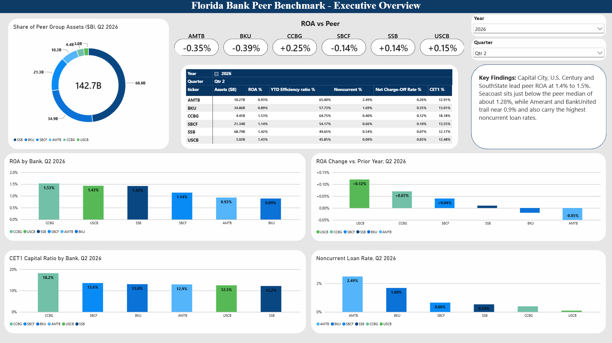

# Florida Bank Peer Benchmark

An automated pipeline and Power BI dashboard that compares six publicly traded Florida banks on profitability, efficiency, credit quality and capital, using FDIC call report data from 2019 through the latest available quarter.


<!-- TODO: add screenshots of all three pages in docs/images/ -->

## The question

How do Florida's public banks compare on the things a bank analyst watches, and where do they differ from their peers? Regulators publish this data every quarter, but pulling it into a repeatable, comparable view usually means one-off spreadsheets. This project replaces that with a pipeline that refreshes itself.

**Peer set (6 banks):** SouthState (SSB), BankUnited (BKU), Seacoast (SBCF), Amerant (AMTB), Capital City (CCBG), U.S. Century (USCB). Every bank has a public ticker. City National Bank of Florida was excluded because it has no public ticker.

## Architecture

```
FDIC BankFind API  ->  Python (requests, psycopg2)  ->  Neon Postgres  ->  SQL view  ->  Power BI
                              ^
                     GitHub Actions (1st and 15th of each month)
```

| Piece | What it does | Why |
|---|---|---|
| `fetch_financials.py` | Pulls every quarter from 2019 onward for each bank in the `banks` table, with pagination, and upserts into Postgres | The bank list lives in the database, not hard-coded, so adding a bank is a one-row insert |
| Neon Postgres | Stores `banks` and `quarterly_financials` | A database and a schedule mean no manual refresh |
| `v_bank_financials` (SQL view) | Renames columns, adds quarter-over-quarter and year-over-year changes, and the peer median for each quarter | The math lives in SQL so Power BI only reads clean, chart-ready columns |
| GitHub Actions | Runs the script twice a month | FDIC data posts quarterly with a lag of roughly seven weeks, so twice a month keeps the pipeline within about two weeks of new data |
| Power BI | Three pages: Overview, Profitability Trend, Credit Risk | Decision-oriented views, not a data dump |

### Design decisions

- **Composite key `(cert, repdte)` with `INSERT ... ON CONFLICT DO UPDATE`.** Reruns update existing rows and never duplicate them, so the job is safe to run twice or after a failure.
- **Median, not mean, for the peer benchmark.** With only six banks, one outlier (for example a bank with a loss quarter) would drag a mean. The median stays stable.
- **Ratios stay as FDIC reports them** (1.42 means 1.42 percent). The dashboard converts them with explicit measures, so formats do not depend on manual number formatting.
- **Post-load completeness check.** After every load the script confirms each bank has rows, all banks have the same quarter count and latest quarter, and the key credit fields are not null. If not, the job fails and GitHub emails me, instead of letting a bad load pass silently.

## Metrics

| Group | Fields | Reading |
|---|---|---|
| Profitability | ROA, ROE, net interest margin (NIM) | Higher is better |
| Efficiency | Efficiency ratio, noninterest expense and income rates | Lower efficiency ratio is better |
| Credit quality | Noncurrent loan rate, net charge-off rate, provision rate | Noncurrent is the early warning, provision is expected loss, net charge-off is realized loss. Lower is better |
| Capital | CET1 capital ratio | Higher means a larger loss cushion |

## What the data shows (Q2 2026)

<!-- TODO: refresh these numbers if Q3 2026 data has loaded -->

- **Two ROA tiers.** Capital City (1.52%), U.S. Century (1.49%) and SouthState (1.42%) sit well above the peer median of about 1.16%. Amerant (0.90%), Seacoast (0.88%) and BankUnited (0.87%) trail it.
- **Size does not explain the gap.** The top tier contains both the largest bank in the set (SouthState, about $69B in assets) and the smallest (U.S. Century, about $3B).
- **Credit quality separates the weaker tier.** Amerant (2.49%) and BankUnited (1.69%) carry the highest noncurrent loan rates, while U.S. Century is lowest at 0.09%.
- **All six banks hold CET1 above 12%,** from 12.2% to 18.2%, so the differences are in earnings and credit, not capital.
- **Seacoast is the open question.** Its ROA is weak, but its margin, credit and capital do not obviously explain it. A natural next step is an ROA bridge (spread, fee income, expenses, provisions).

**Caveats:** one quarter, six banks, and the analysis is descriptive, not causal.

## What broke, and what I learned

- **A mislabeled credit field.** I first stored the FDIC noncurrent loan ratio (`NCLNLSR`) under a column I was treating as net charge-off. They are different measures: noncurrent loans are 90+ days past due or not accruing, while net charge-offs are realized losses. I caught it by comparing both fields for the same bank and quarter (Seacoast showed 0.66% noncurrent against 0.10% net charge-off). I added the true net charge-off field (`NTLNLSR`), relabeled the columns and rebuilt the view.
- **A silent partial migration.** A multi-column `ALTER TABLE` applied only some columns, and new columns stayed NULL until the script was updated and rerun. This is why the completeness check now exists.
- **A view that could not be replaced.** `CREATE OR REPLACE VIEW` cannot rename columns, so renames need `DROP VIEW` first.
- **A dashboard aggregation trap.** Power BI sums by default, which turned snapshot charts into sums across quarters. The fix was explicit average measures and quarter slicers.

## Known limitations and next steps

- `cost_of_deposits` in the view divides a rate by a dollar amount and should be replaced by the interest expense rate (cost of funds). Nothing on the dashboard uses it.
- No alerting beyond GitHub's failed-run email.
- Planned: a forecasting layer in Python (trailing eight quarters, four-quarter horizon, stored in its own table), reserve coverage, and a valuation view (price to tangible book against ROTCE).

## Run it yourself

```bash
git clone <this repo>
cd florida-bank-benchmark
python -m venv venv && source venv/bin/activate   # Windows: venv\Scripts\activate
pip install -r requirements.txt
cp .env.example .env    # then set DATABASE_URL
psql "$DATABASE_URL" -f schema.sql
python fetch_financials.py
```

Never commit `.env`. In GitHub Actions the connection string is stored as the `DATABASE_URL` repository secret.

## Data source

FDIC BankFind Suite, financials endpoint: https://banks.data.fdic.gov/docs/
